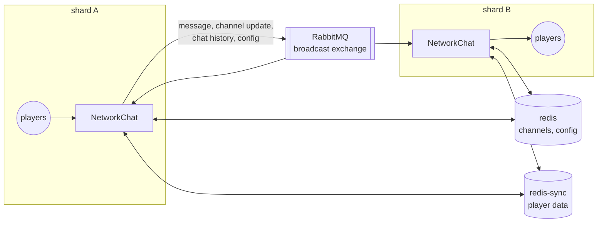
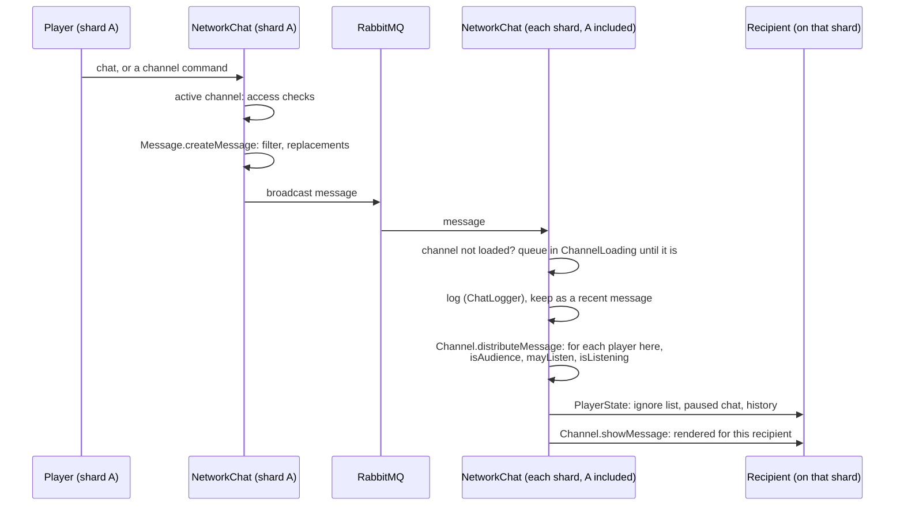
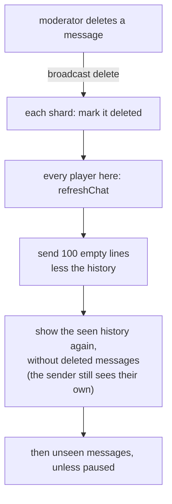
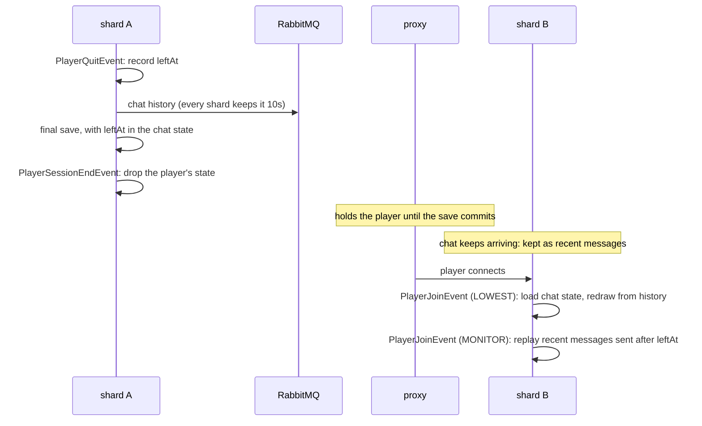

# Network chat: design

How chat gets from one player to the others across every shard: where channels and player state
live, the path a message takes, how chat is redrawn when a message is deleted, and what happens
when a player moves between shards. Configuration and logging are in the [README](README.md).

## The pieces

Every shard runs the plugin. Shards share state through redis, and talk to each other through
RabbitMQ (via network-relay). There is no central chat server: each shard decides for itself
which of its own players see a message.

| Class | Role |
|---|---|
| `Channel` and subclasses | One channel: who may talk and listen, which players a message is for, how it is shown |
| `ChannelManager` | Loading, saving and naming channels; applies channel updates from other shards |
| `Message` | One message: sender, channel, text, extra data (origin shard, world, team, whisper receiver) |
| `MessageManager` | Sends messages to every shard, receives them, deletions and chat clears |
| `PlayerState` | One player's chat state: channels joined and watched, active channel, settings, ignores, paused |
| `PlayerChatHistory` | What a player has been shown, so chat can be redrawn |
| `PlayerStateManager` | Player join, quit and save; chat packets; chat history between shards |
| `RemotePlayerListener` | Player names and hovers for players on other shards (network-relay remote players) |
| `ChatFilter`, `inlinereplacements` | Filtering and replacements applied when a message is created |

## Where state lives

| State | Where | Lifetime |
|---|---|---|
| Channels | redis `networkchat:channels` (UUID to JSON), names in `networkchat:channel_name_to_uuids` | Until deleted |
| Channels every shard loads at startup | redis `networkchat:forceloaded_channels` (every channel that is not invite-only) | Until deleted |
| Formats, colors, filters, default channels, message visibility | redis `networkchat:config` | Until changed |
| A player's chat state (`PlayerState`) | redis-sync plugin data `NetworkChat`, saved with the player | With the player |
| Loaded channels | each shard's memory; party and whisper channels only while someone on the shard uses them | Unloaded when unused |
| Chat history | memory of the player's shard; broadcast to all shards when they leave | 10s after leaving |
| Recent channel messages | each shard's memory | 120s |

## Channels

| Type | Who sees a message (`isAudience`, then `mayListen`) |
|---|---|
| `ChannelGlobal` | Everyone with access, on every shard |
| `ChannelAnnouncement` | Everyone with access; only those given chat access may talk |
| `ChannelLocal` | Players on the shard it was sent from |
| `ChannelWorld` | Players in the world it was sent from |
| `ChannelParty` | Its members |
| `ChannelTeam` | Members of a scoreboard team, created on first `/teammsg` |
| `ChannelWhisper` | The two players of one conversation; also sets the reply target for `/r` |
| `ChannelLoading` | Placeholder while a channel loads: queues messages and waiting players |
| `ChannelFuture` | A channel type this version does not know: shows nothing |

A channel's settings and access are changed on one shard, saved to redis and broadcast as a
channel update, which every other shard applies when it arrives.

When a message arrives for a channel a shard has not loaded, the shard puts a `ChannelLoading`
in its place and reads the channel from redis. The message waits in it. Whichever arrives first,
the redis read or a channel update, replaces the placeholder and delivers what it queued.

## A message's path

Three steps, each owned by one class:

1. **Who.** `Channel.distributeMessage` asks, for each player on the shard, whether they are in
   the message's audience (`isAudience`), may listen to the channel (`mayListen`), and are
   listening (`isListening`). Channels override `isAudience` and `mayListen`; the loop itself is
   shared.
2. **When.** `PlayerState.receiveMessage` drops messages from ignored players. The player's
   `PlayerChatHistory` shows the message now, or keeps it as unseen while chat is paused.
3. **How.** `Message.showMessage` asks the channel to render the message for this recipient
   (`Channel.showMessage`): formats, colors and hover text can differ per player.

Messages that do not come from a channel (other plugins' system messages) are seen in outgoing
chat packets (ProtocolLib) and recorded in the history as external messages, so a redraw shows
them too.

## Redrawing chat

The client cannot remove one line of chat. To take back a message, the server redraws all of it.

`PlayerChatHistory` keeps up to 100 seen messages (the vanilla chat limit), unseen messages while
paused, and messages that arrive during a redraw. The same redraw runs on join for clients on
protocol 765 (1.20.3 and 1.20.4).

## Moving between shards

A player's chat state travels with their data (redis-sync), so channels, settings and ignores
follow them. Two more things travel separately:

- **Chat history.** When a player leaves, their shard broadcasts their history to every shard.
  The shard they join uses it to redraw their chat; the others discard it after 10 seconds.
- **Messages sent while they were away.** On a clean transfer, the proxy holds the player between
  shards until their data is saved, so for a while no shard has them. Every shard keeps the
  channel messages it has seen for 120 seconds. The final save records when the player quit
  (`leftAt`), and redis-sync guarantees that save is the data the next shard loads.

The replay happens at the end of the join, once other plugins have set the player up on the
shard (their team, their world), and goes through the same `isAudience` and `mayListen` checks
as live chat. So a player arriving on shard B sees B's local chat from the hold, not A's, and
team, party and whisper rules apply as they would have. A replayed whisper sets the reply
target. A player who logs out and back in within 120 seconds gets the same replay.

## Messages between shards

| network-relay channel | Sent when | Each shard |
|---|---|---|
| `com.playmonumenta.networkchat.Message` | A message is sent | Distributes it to its players |
| `...Message.delete`, `...Message.deleteFromSender` | A moderator deletes a message, or all of a sender's | Marks it deleted, redraws chat |
| `...Message.clearChat` | A moderator clears chat | Clears every player's chat |
| `com.playmonumenta.networkchat.channel.Channel.update` | A channel is created, changed or deleted | Applies the update |
| `com.playmonumenta.networkchat.player_chat_history` | A player leaves a shard | Keeps their history 10s |
| `com.playmonumenta.networkchat.config_update` | Formats, filters, defaults or visibility change | Reloads the config |

network-relay processes received messages on the main thread, in the order they arrived.
