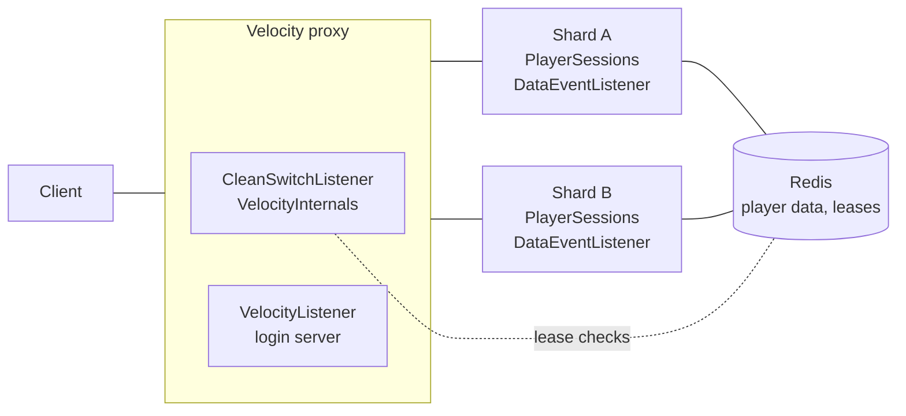
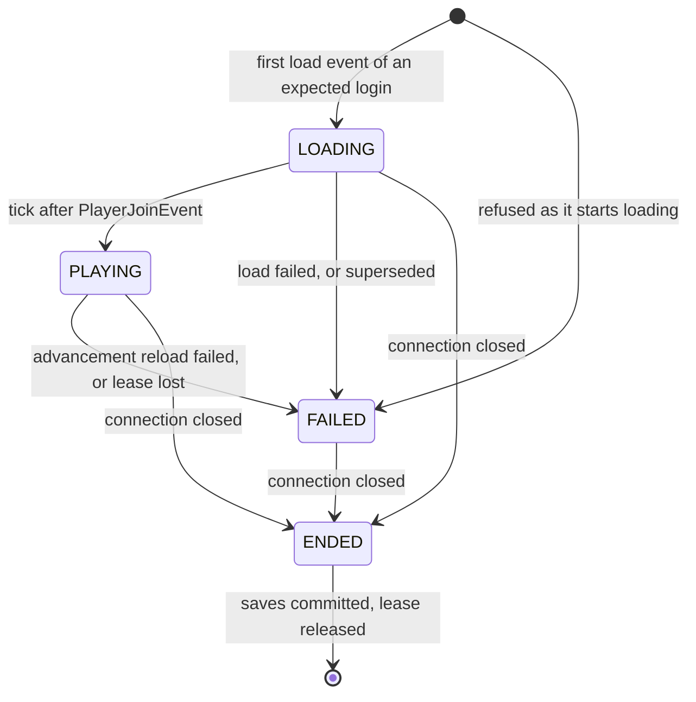
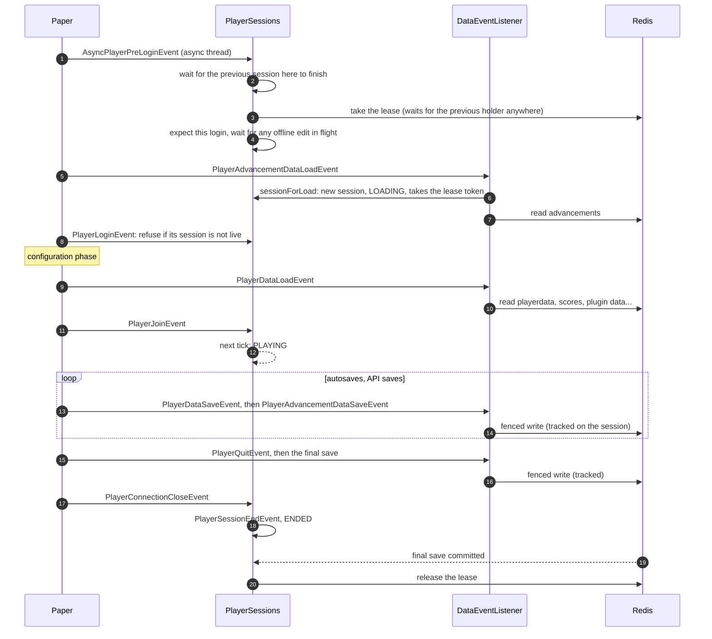
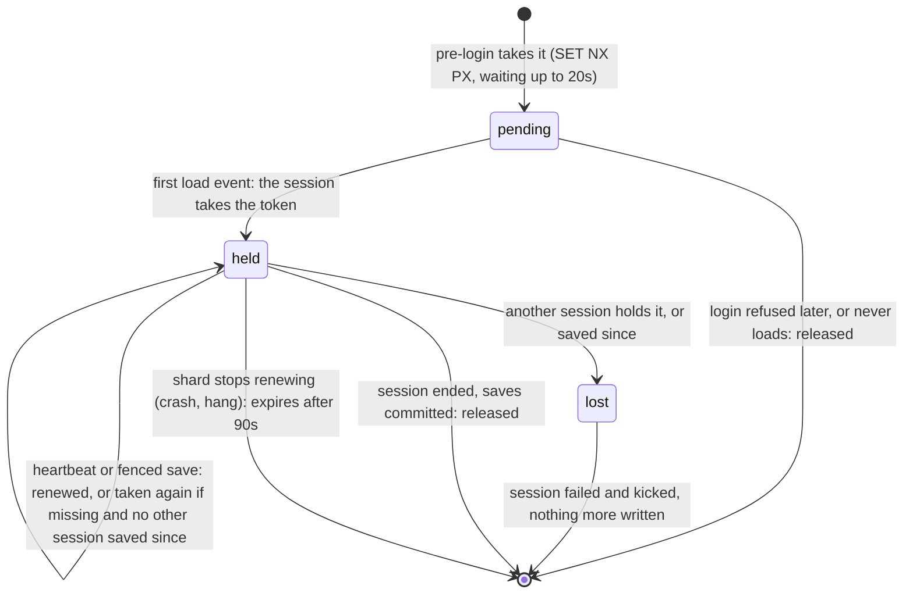
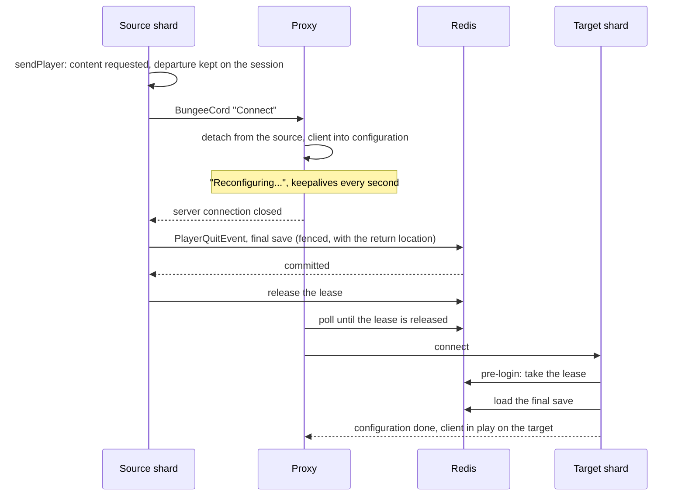
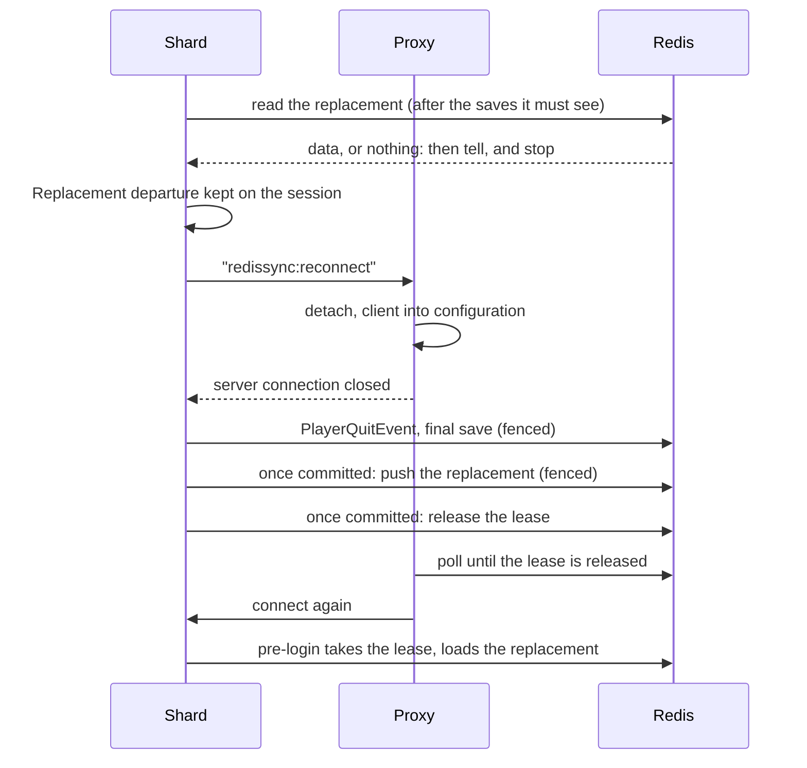

# Player data across shards: design

How a player's data moves between redis, the shards and the proxy: when it is loaded, when it is
saved, and how a player gets from one shard to another without either shard seeing stale data.
What other plugins can rely on is summarized in the
[README](README.md#how-player-data-is-saved-and-loaded); this document explains how it is
achieved.

## The problem

A shard loads a player's data from redis when they log in, and saves it back while they play
and when they leave. A player must always load their newest save, and nothing may ever save
stale or partial data over it. What makes that hard:

- **Saves commit later.** A save hands commands to redis and returns at once. Redis may take
  100ms or more to run them, and a reconnect, a transfer or a shutdown can arrive in between.
- **A player moves between shards.** The shard they left and the shard they arrive on are
  separate processes that see each other only through redis. Without coordination, the new one
  can load before the old one's last save has landed.
- **Connections overlap.** A player can log in again before their previous connection has
  closed. Plugins can hold on to an old `Player` object, or construct fake players that fire load
  events but never disconnect.
- **Shards fail.** A shard can crash, or hang and then resume, while its players have moved on.
- **The server's events are not a clean lifecycle.** Kicks before the game connection exists do
  nothing. The connection close event carries only a UUID, and may fire off the main thread.

## The pieces

The same plugin jar runs on every shard and on the proxy.

- **On each shard**, `PlayerSessions` tracks every connection as a `PlayerSession`, and decides
  whether a load or save event may proceed. `DataEventListener` does the loading and saving.
  `SessionLease` is the player's lease in redis, which says which session (on which shard) may
  save their data.
- **On the proxy**, `CleanSwitchListener` makes every server switch leave the old server
  completely before the new one is connected, and holds the client meanwhile. `VelocityListener`
  remembers each player's last server, which is where their next login goes.
- **Redis** holds the data and the leases. Everything that orders one shard against another goes
  through it.

The core idea: **a player's data has one owner at a time**, the session holding their lease.
A session takes the lease as it logs in, writes only while it holds it, and releases it once its
last save has committed. A transfer is then just a logout followed by a login, and the login
cannot load until the logout's save is in.

## Data in redis

| Key | Holds |
|---|---|
| `<domain>:playerdata:<uuid>:data`, `:advancements`, `:scores`, `:plugins`, `:content`, `:history` | History lists, newest first. Every full save pushes one entry onto each, so index *n* of every list is the same save |
| `<domain>:playerdata:<uuid>:sharddata` | Hash: position and world per shard and world, outside the history |
| `<domain>:session:<uuid>` | The session lease: the token of the session that may save, with a TTL |
| `<domain>:session:<uuid>:writer` | The token of the last session that saved the player, kept an hour |
| `<domain>:stash` | Hash of stashed saves, by name |
| `<domain>:bungee:locations` | Hash: each player's last server, kept by the proxy |

Rollback, stash and loadFromPlayer read every list at one index, so the lists must stay aligned.
A full save is two Lua scripts on one connection: one writes playerdata, scores, plugin data,
content, history and shard data together, the other advancements. Both check the lease first
(see Session leases). That connection is FIFO, so a player's saves commit in the order they were
made.

## Components

| Class | Where | Role |
|---|---|---|
| `PlayerSession` | shard | One connection: its state, the data cached from redis, its saves that have not committed, its lease token, and the departure it is waiting on, if any |
| `PlayerSessions` | shard | The registry of sessions. Login, disconnect, the lease heartbeat, departures, and whether a load or save may go ahead |
| `SessionLease` | shard, proxy | The lease: taking, renewing, fenced writes, releasing |
| `DataEventListener` | shard | Paper's load and save events, to and from redis |
| `MonumentaRedisSyncAPI` | shard | `sendPlayer`, stash, rollback, loadFromPlayer and offline edits, built on the above |
| `CleanSwitchListener` | proxy | Takes over server switches: detach, hold, wait for the lease, connect, fall back |
| `VelocityInternals` | proxy | The few Velocity internals a clean switch needs, found by reflection |
| `VelocityListener` | proxy | Stores each player's last server, and sends logins there |

`PlayerSessions` and `DataEventListener` split *whether* from *how*. Every load and save event
first asks `PlayerSessions` which session it belongs to (`sessionForLoad`, `sessionForSave`). A
save goes ahead only into a session that can save, and a load only into a live one.

## Sessions

A `PlayerSession` covers one connection, from its first load event until Paper's
`PlayerConnectionCloseEvent`. It belongs to one `Player` object (Paper creates one per
connection), and events are matched to it by object identity, not UUID. A plugin holding a
`Player` from an earlier connection therefore cannot save its stale state over the current one,
or transfer it. Waiting for saves goes by UUID, so a login can wait for the previous
connection's.

- **LOADING.** Not saved yet: other plugins load their own state in their join handlers, and a
  save before then would write their empty state. Saving starts on the tick after
  PlayerJoinEvent, since other MONITOR handlers may still run after this plugin's.
- **PLAYING.** Saved.
- **FAILED.** The load failed, the connection was refused, a newer login superseded it while it
  was still loading, or another session took its lease. Never saved, since that would put partial
  or stale data over the real thing. The player is refused at PlayerLoginEvent if that is still
  to come, and kicked otherwise.
- **ENDED.** The connection has closed. PlayerSessionEndEvent fires just before, for plugins to
  drop what they keep for the player: every later login of the player waits for this session to
  end (here, directly; elsewhere, through the lease), so no plugin needs a timer to tell a stale
  cache from a new one. An ended session stays registered until every save it made has
  committed, so a reconnect here can wait for it. Then its lease is released and it is removed.

Everything the plugin caches for the player (plugin data, shard data, content data) lives on the
session, so it disappears when the connection closes.

### Which connections get a session

Only logins that pass `AsyncPlayerPreLoginEvent` get a session that is kept. Any other load event
gets one that is not: it loads as usual, but nothing saves it, and nothing ends it. That covers
NPC plugins' fake players, which fire load events but never a close event.

Pre-login records the login as *expected* for a minute, and takes the player's lease. Its first
load event takes both. A login that drops in between leaves no close event, so the expectation
expires (and its lease is released) rather than lingering until some fake player with the UUID
starts a session that never ends.

### Which connection a close belongs to

The close event carries only a UUID. That is ambiguous only when two connections for one account
are here at once. Velocity never does that, but a proxy bug could. `connectionClosed` attributes
each close:

1. A second connection that starts loading while the account already has a session is refused.
   Once PlayerLoginEvent has refused it too, the next close is taken as its. Fake players are
   refused the same way, but never reach PlayerLoginEvent, so no close is expected of them. This
   check comes first, or the established session's own close would be taken for the refused one's.
2. Paper takes a player out of the game before their own connection's close fires. So if the
   session's player is still in the game, the close is another connection's, and is ignored.
3. Otherwise the session ends.

The one case this cannot resolve is a second connection that drops before loading while the
first is still configuring: its close ends the first connection's session, and the first is
kicked at join for having none. The worst case is a refused login, never unsaved play.

## A connection's life

A player reconnecting straight after leaving can reach pre-login before their previous
connection here has closed, or before its final save has committed. Pre-login, on its async
thread (the one place a login can block), therefore waits up to `TIMEOUT_SECONDS` for the
previous session's `finished()`: closed, with every save it made committed. It then takes the
lease, which covers the same wait for a session on another shard.

If the previous connection is still open (the client dropped and came back before the server
noticed), the newest login wins, as in vanilla. Pre-login supersedes the old connection before
anything loads, and waits for it as above. A playing connection is kicked, which saves it. One
still loading cannot be kicked during configuration, so it is failed instead: it never saves,
and is kicked when it joins.

## Saves, and waiting for them

Every write of a player's data made through their session is tracked on it: their saves, and a
handoff's replacement. `savesCommitted()` completes when all of them have been acknowledged by
redis, successfully or not; failures are logged as they happen. `finished()` is the same, but
only once the session has ended, so no more can be added.

| Who waits | For | Where |
|---|---|---|
| A login here | the previous session's `finished()` | `PlayerSessions.waitForPreviousSession` |
| A login anywhere | the previous session's lease release, which follows its `finished()` | `PlayerSessions.acquireLease` |
| The proxy, switching a player | the lease release | `CleanSwitchListener.awaitLeaseReleased` |
| Rollback, loadFromPlayer | the saves made so far (the source player's, for loadFromPlayer), before reading | `MonumentaRedisSyncAPI.replaceData` |
| `stashPut` | the player's saves | `PlayerSessions.waitForSaves` |
| Shutdown | every session's saves, and every other player data write | `PlayerSessions.onDisable` |

API writes made outside a session's saves (location setters, stash writes, offline edits) are
tracked separately (`trackWrite`), for shutdown only.

### Keeping the advancements history aligned

A full save fires PlayerDataSaveEvent, which pushes onto every list but advancements, and then
PlayerAdvancementDataSaveEvent, which pushes advancements. The server also saves advancements on
their own, before a datapack reload. Pushing that would leave an advancements entry with no
matching entry on the other lists, and every index into the history after it would pair the
wrong saves. So the session remembers that the newest advancements entry is unpaired. Further
lone advancements saves replace it, and so does the next full save's, which pairs it again.

## Session leases

`SessionLease`: the key `<domain>:session:<uuid>` holds the token (`<shard>:<random>`) of the one
session allowed to save the player's data. It is the cross-shard counterpart of the wait for the
previous session in pre-login, which only covers this shard.

- **Taken** at pre-login (HIGHEST), after the wait for a previous session here (LOWEST), whose
  release it may be waiting on. `SET NX` and a `GET` of the holder run in one MULTI, retried with
  backoff for up to 20 seconds, which stays under Velocity's 30 second read timeout for a backend
  login. A login refused afterwards (MONITOR) releases it; the token is handed from one handler
  to the other through a thread-local, as both run on the same pre-login thread.
- **Renewed** every 10 seconds (200 ticks) by one script per shard, from the main thread, covering
  every session and pending login there, so the cost scales with shards, not players. Counting in
  ticks means a shard whose main thread stops (a crash, a hang) stops renewing, and its leases
  expire after 90 seconds; a shard that is only slow keeps them unless it stays under about 2 TPS
  for the whole TTL. Every save extends the lease too. A lease the heartbeat finds held by someone
  else means this session has been replaced: it is failed and kicked. The heartbeat takes a missing
  lease again only for a session still playing; for an ended session or a pending login it only
  extends one that exists, since an ended session's lease may have been released a moment before.
- **Fenced.** Every save, and a handoff's replacement, is one script that writes only if the
  session's token holds the lease, or the lease is missing and the last writer
  (`<domain>:session:<uuid>:writer`) is this session or nobody (then it takes it again). The
  script records the writer. A session whose shard hung past the TTL, while the player logged in
  elsewhere, therefore writes nothing when it resumes, even if the other session has already
  left and released the lease: the script fails with `LEASE_LOST`, and the session is kicked.
- **Released** once the session has ended and every write it made has committed, so whoever takes
  it next finds them all. At shutdown, the leases of sessions whose saves committed are released;
  any others are left to expire. A plugin reload releases leases this shard holds for players it
  finds online.
- **Missing** (redis restarted, a moderator cleared it) is not an error: the holder's next save or
  heartbeat takes it again, unless someone else has taken it or saved the player meanwhile.
- **Offline edits** are refused while a lease exists, since the player is then online somewhere.

`/sessionlease <player> [clear]` shows the holder and its remaining time, or deletes it.

## Leaving a shard: transfers and handoffs

A session can be waiting on one **departure** (`PlayerSession.Leaving`): the proxy has been
asked to take the player off this shard, and has not yet. There are two kinds:

- **`Transfer`** to another shard (`sendPlayer`), with an optional return location.
- **`Replacement`**: a data handoff (stash get, rollback, loadFromPlayer) that replaces the
  player's saved data and brings them straight back to this shard.

Either way nothing is locked or frozen. The player plays on, and is saved as usual, until the
proxy takes them off, which takes milliseconds. `getDeparture` describes the pending departure
(the public `Departure`: a `Transfer` with its target and content, or a `Handoff`) from the
request until the player leaves, including during PlayerQuitEvent; `PlayerSessionEndEvent`
carries it too. If the player is still here and still connected after the timeout (10 seconds;
25 ticks for a transfer to a shard network relay does not list as online), the proxy never
acted: the departure is dropped, and the player is told. A player whose connection has already
closed is on their way out, so the timeout leaves them alone.

### Transfers

The return location is applied to every save from the request on, so the logout save carries it.
Plugins' PlayerQuitEvent handlers run before that save, so their changes are in it; they can tell
a transfer from a logout with `getDeparture`. Anything a transfer must enforce in that save
belongs there, since the player plays on until they leave. A content passed to `sendPlayer` is
requested (PlayerContentChangeRequestEvent) just before the proxy is asked, and recorded in the
departure.

The old transfer events are kept as deprecated bridges, scheduled for removal, so plugins built
against older versions still load: `sendPlayer` fires `PlayerServerTransferEvent` (both the
redis-sync and MonumentaCommon copies; cancelling either cancels the transfer) before anything
else, and `PlayerTransferFailEvent` (both copies) when the departure times out or the request
throws. A transfer the proxy accepts and then cannot complete fires no fail event: the player
comes back as a new login. `isPlayerTransferring` is `getDeparture(player) != null`. Paper logs a
deprecation warning for every listener registered for these events.

### Data handoffs

The replacement is read first, while the player plays on, so a missing stash or a rollback past
the end of history changes nothing. A rollback index counts back from the newest save made
before the call, which the read waits for. The final save is pushed before the replacement, so it
stays in the player's history just below it, as a way back. A player who logs out instead of
being reconnected gets the replacement all the same; so does one still online when the shard
shuts down, since `onDisable` writes pending replacements after the shutdown saves.

## The proxy: clean switches

`CleanSwitchListener` takes over every `ServerPreConnectEvent` of a player who has a current
server, whoever started it: a shard's BungeeCord "Connect", Velocity's `/send`, other plugins. It
runs last, so the destination is whatever other plugins made it.

1. **Deny and detach.** The event is denied. Instead, on the client connection's event loop, the
   first half of Velocity's own switch (`ClientPlaySessionHandler.doSwitch`) runs: it detaches
   and closes the current server connection, clears what Velocity tracked from it (tab list, boss
   bars), and sends the client into the configuration phase. To the source shard this is an
   ordinary disconnect.
2. **Hold.** The client shows "Reconfiguring..." (the client's own `connect.reconfiguring`
   text). The proxy sends a keepalive every second: a client in configuration, as in play, drops
   after 30 seconds without packets. Its Disconnect button unlocks after about 30 seconds. With no
   server attached, Velocity drops whatever the client sends; nothing reaches a shard.
3. **Wait for the lease.** The proxy polls the lease key (10ms, doubling to 200ms) until it is
   gone, for up to the lease TTL plus 5 seconds. Waiting here has no limit but the client's
   patience; the target's own wait in pre-login only has as long as Velocity's read timeout
   allows. Normally the source has released it by the first or second poll. A wait over a second
   is logged.
4. **Connect** to the target, as for a login. This connect fires `ServerPreConnectEvent` again,
   which the listener lets through for the server it is connecting to, and denies for anything
   else while the switch is under way.
5. **Fall back.** If the target refuses or fails, the player is connected back to the server they
   came from, an ordinary login there, and told. If that fails too, they are disconnected. Their
   data is saved either way.

A shard can also ask for a clean reconnect to itself with the `redissync:reconnect` plugin message
(a data handoff). Velocity would refuse a "Connect" to the current server before any event fires,
hence the separate channel. Only messages from a server are acted on, and none is forwarded to
the client.

**Why every switch.** Velocity's own switch connects to the target before it leaves the source.
With leases, the target's login would wait for the source's save, which only comes once the
player has left the source: it would be refused after 20 seconds. Pre-connects with no current
server (logins, redirects after a kick) are left alone; Velocity has already left the old server,
and the target's lease wait covers them.

**Velocity internals.** `VelocityInternals` finds these by name at startup, and logs "Clean
server switches enabled" if they are all there. They have been unchanged since Velocity's 1.20.2
support (3.3.0):

| Internal | Used for |
|---|---|
| `ConnectedPlayer.getConnection()`, `MinecraftConnection.eventLoop()` | running the detach on the client's event loop |
| `MinecraftConnection.getActiveSessionHandler()`, `ClientPlaySessionHandler.doSwitch()` | the detach itself; its future completes when the client acknowledges |
| `ConnectedPlayer.sendKeepAlive()` | keepalives, whose replies Velocity ignores |

If any is missing, a switch stores the target as the player's login server and disconnects them
with "Please reconnect".

## Chat across a transfer

While the proxy holds a player, no shard has them, so no shard shows them chat. network-chat
replays what they missed on arrival, from the quit time it writes into the final save: see
[network-chat's ARCHITECTURE.md](../network-chat/ARCHITECTURE.md#moving-between-shards).

## When things go wrong

| Situation | What happens |
|---|---|
| Target shard down or refusing | The proxy's connect fails; the player is back on the source within a second, told why |
| Proxy never acts on a request (unknown target) | The departure times out on the source; the player is told |
| Source save slow | The proxy holds the player until the lease is released |
| Source shard crashes | Its leases expire within 90 seconds; meanwhile the proxy holds a switching player, and other logins wait 20 seconds and are refused ("Your previous session is still saving") |
| Source shard hangs, then resumes | As a crash; once the player is elsewhere, the resumed shard's saves fail with `LEASE_LOST` and nothing is written |
| Lease left behind by a bug | Expires within 90 seconds; `/sessionlease <player> clear` frees it at once |
| Redis loses the lease | The holder's next save or heartbeat takes it again, unless another session saved the player since |
| Proxy's redis stalls | Each lease check gives up after 5 seconds and connects anyway; the target's login decides |
| Player clicks Disconnect during a hold | The source has already saved and released; they can rejoin at once |
| Shard shuts down with players online | Saved and released in `onDisable`; pending handoffs written first |
| A save fails (redis error) | Logged, not retried; the lease is still released, so the next login loads the save before it |

## Offline edits

This plugin is not a way to change offline players' data. `getOfflinePlayerData` and
`saveOfflinePlayerData` exist to feed saved player data through the current Minecraft version's
DataFixer (`/monumenta redissync upgradeallplayers`), run during maintenance with no players
online.

The write still guards against what it can see. It is refused while the player holds a lease
(online somewhere), has a session here, or has a login under way here, and a login here waits for
a write in flight: the write's claim (`PlayerSessions.claimOfflineWrite`) and pre-login's
expectation are taken under the same monitor. The write is a Lua script that pushes only if the
newest history entry is still the one the edit was read from, so it never buries a save made
since.

## Threads

| Thread | Runs |
|---|---|
| Async pre-login | waiting for the previous session, taking the lease, waiting for offline writes, expecting the login |
| Main | load and save events, join, close handling, session state, departures and their timeouts, the lease heartbeat |
| Redis callbacks | completing tracked saves; writing a replacement and releasing a lease once saves commit; scheduling anything else onto the main thread (`PlayerSessions.runOnMainThread`) |
| Proxy event loops and scheduler | the detach (client event loop), keepalives, lease polling, connecting |

The close event can fire on any thread, and is handled on the main thread.

## The Paper event order this relies on

These come from the Paper 1.20.4 server jar's bytecode, not from documentation. To re-check them
for a new version, run `javap -c` on the paperweight-mapped server jar (under
`.gradle/caches/paperweight/taskCache/` in monumenta-mixins), and read `Connection`,
`PlayerList` and the `Server*PacketListenerImpl` classes.

- **Login.** AsyncPlayerPreLoginEvent fires on an async thread. Then, on the main thread, the
  ServerPlayer is constructed, which loads advancements (PlayerAdvancementDataLoadEvent). Then
  PlayerLoginEvent fires. Then `PlayerList.disconnectAllPlayersWithProfile` kicks any player
  already in the game with the same UUID. That is too late, because the new player's
  advancements have already loaded, which is why pre-login closes an old connection itself. A
  configuration phase follows. Then `placeNewPlayer` runs: PlayerDataLoadEvent, the player
  becomes visible, then PlayerJoinEvent.
- **Save.** `PlayerList.save` fires PlayerDataSaveEvent, then PlayerAdvancementDataSaveEvent.
- **Disconnect.** `PlayerList.remove` fires PlayerQuitEvent, saves the player synchronously, and
  removes them. Only after that does PlayerConnectionCloseEvent fire. So when a session ends,
  its final save has already been handed to redis.
- **Kick.** `PlayerList.remove` runs at once. The connection closes, firing the close event, on
  a later network tick.
- **Kicks before the game connection exists do nothing.** `CraftPlayer.kick` returns early
  during the advancement load and the configuration phase. A connection that fails while
  loading advancements is therefore refused at PlayerLoginEvent rather than kicked.
- **The close event** fires for configuration and game connections, and for login connections
  from the VERIFYING state on, which covers a refusal at PlayerLoginEvent. It does not fire for
  a login refused at AsyncPlayerPreLoginEvent. It carries only a UUID, and is not guaranteed to
  fire on the main thread.
- **`Player.isConnected()`** turns false as soon as the network connection closes, before the
  main thread processes the quit. The plugin compiles against the 1.20 API, which lacks it, so it
  is reached through the version adapter.
- **Shutdown with monumenta-mixins.** `MinecraftServerMixin` saves and removes every online
  player, sleeps 100ms, and only then disables plugins. No close events arrive, because the
  network has already stopped, so `onDisable` waits on every registered session.
- **Datapack reload.** `reloadResources` saves each player's advancements on their own, reloads
  them (firing the advancement load again), then fires ServerResourcesReloadedEvent. The plugin
  makes a full save at that event, which pairs the lone advancements entry.
